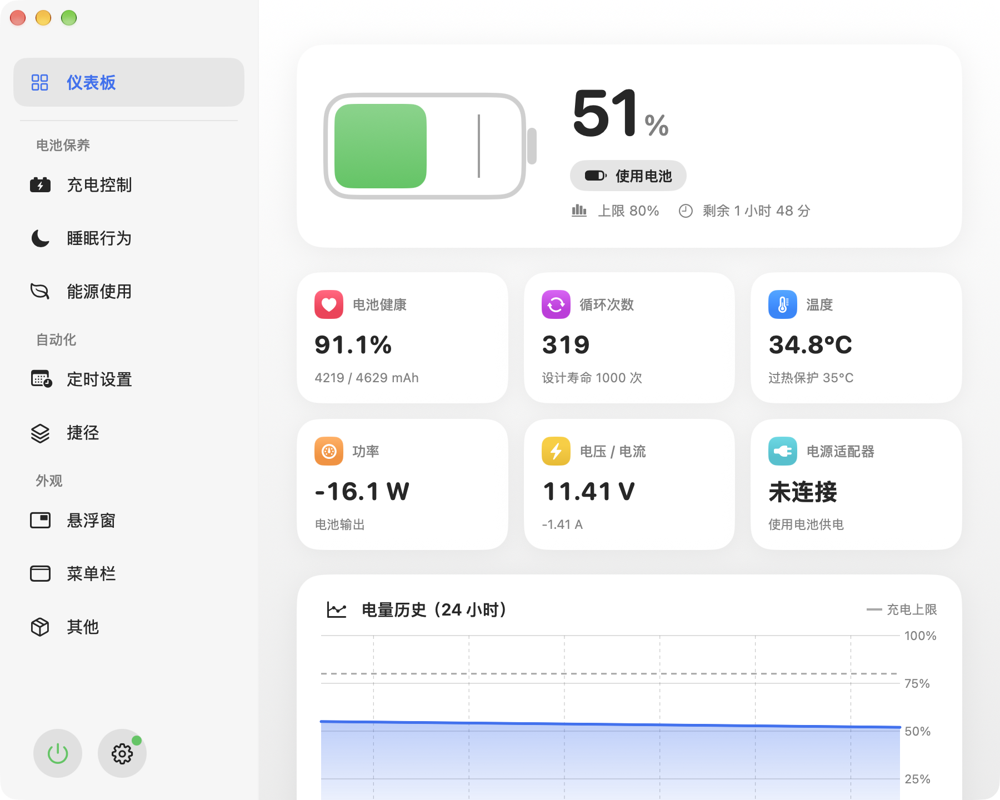
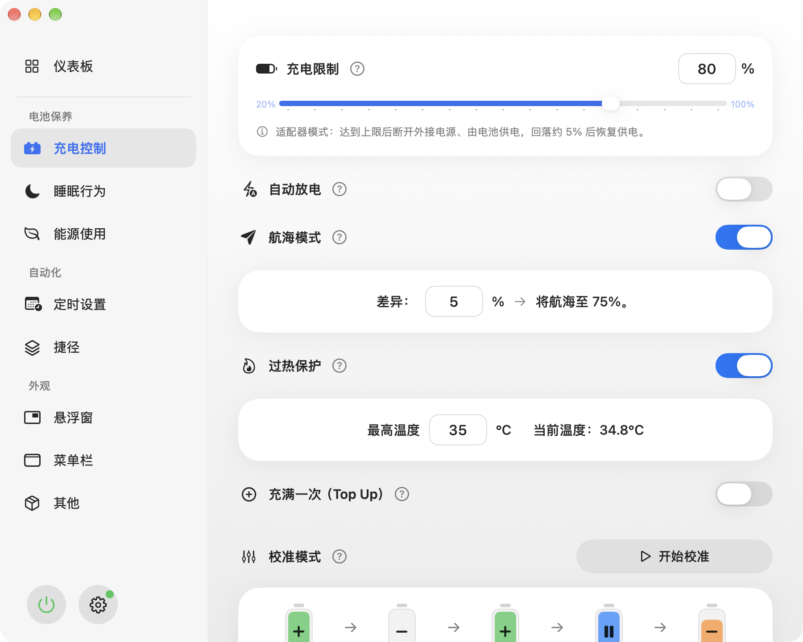

<div align="center">

# 🔋 电池管家 BatteryCare

**一款原生、美观、开源的 macOS 电池保养工具**

让 MacBook 长期插电也不再把电池充到 100%，延缓电池老化。




</div>

## ✨ 功能

| | 功能 | 说明 |
|---|---|---|
| 🔌 | **充电限制** | 20%–100% 任意设置，到达上限后停止充电 |
| ⛵ | **航海模式** | 到达上限后，电量需回落一段才重新充电，避免反复微循环 |
| 🔥 | **过热保护** | 电池温度超过阈值时暂停充电，降温后自动恢复 |
| ⬇️ | **自动放电** | 电量高于上限时，即使插着电源也主动放电到上限 |
| ➕ | **充满一次** | 出门前临时充到 100%，充满后自动恢复原限制 |
| 🎚️ | **校准模式** | 充满 → 放到 10% → 充满 → 保持 1 小时 → 放到上限，全自动 |
| 📊 | **仪表板** | 健康度、循环次数、温度、功率、电压电流、适配器信息、24 小时电量曲线 |
| 🌙 | **睡眠行为** | 充到上限前阻止睡眠、睡眠时停止充电、退出应用时保持暂停 |
| ⚡ | **能源使用** | 低电量模式策略（始终 / 从不 / 仅电池），实时列出高 CPU 占用应用 |
| 🗓️ | **定时任务** | 每天 / 每周 / 每月自动校准、改限制、开关低电量模式，带执行历史 |
| 🧩 | **快捷指令** | URL Scheme + 命令行，可接入 macOS「快捷指令」 |
| 🪟 | **悬浮窗** | 置顶的小电量胶囊，可拖动定位，不拦截鼠标 |
| 🧭 | **菜单栏** | 多种图标样式，可选显示温度、功率、循环等信息，弹出快捷控制面板 |
| 💡 | **MagSafe LED** | 关闭指示灯、到达上限显示绿色、放电时橙色闪烁 |
| 🎨 | **外观** | 浅色 / 深色 / 跟随系统，毛玻璃侧边栏，可降低透明度 |
| 🔄 | **检查更新** | 每天自动检查 GitHub Releases，一键下载安装并重启；辅助程序过期时提示更新 |

<div align="center">

</div>

## 📦 安装

### 方式一：下载（推荐）

前往 [Releases](https://github.com/245678000000/BatteryCare/releases/latest) 下载 `BatteryCare-x.y.z.dmg`，打开后把「电池管家」拖到「应用程序」文件夹。

> 应用未经 Apple 公证。首次打开如提示“无法验证开发者”，请右键点击应用 →「打开」，或在「系统设置 → 隐私与安全性」中点击「仍要打开」。也可以在终端执行：
> `xattr -dr com.apple.quarantine /Applications/BatteryCare.app`

### 方式二：从源码构建

需要 macOS 14+、Apple Silicon 和 Xcode 命令行工具（`xcode-select --install`）。

```bash
git clone https://github.com/245678000000/BatteryCare.git
cd BatteryCare
./build.sh                       # 生成 dist/BatteryCare.app
mv dist/BatteryCare.app /Applications/
open /Applications/BatteryCare.app
```

### 退出与程序坞

默认情况下，**关闭窗口、在程序坞中选择“退出”或按 ⌘Q** 只会把电池管家隐藏到菜单栏，后台继续管理充电，不占用程序坞；打开窗口时程序坞图标才会出现。

要**完全退出**，请点击菜单栏面板里的「退出」或按 **⌥⌘Q**。可在「其他 → 程序坞图标」中改为“始终显示”或“从不显示”。

### 首次使用

打开后点击左下角 **⚙︎ 齿轮 → 安装**，输入管理员密码安装后台辅助程序。齿轮上的小圆点为绿色即表示正在运行。

## ⚙️ 工作原理

```
┌──────────────────────┐   control.json   ┌───────────────────────────┐
│  BatteryCare.app     │ ───────────────▶ │  batterycare-helper       │
│  SwiftUI 界面 / 菜单栏 │                  │  LaunchDaemon（root）       │
│  读取 IOKit 电池数据   │ ◀─────────────── │  每 3 秒按规则写 SMC 键      │
└──────────────────────┘   status.json    └───────────────────────────┘
          /Users/Shared/BatteryCare/                   │
                                                       ▼
                                               AppleSMC（硬件）
```

- **应用**（`Sources/BatteryCare`）只负责界面和设置，不需要 root。
- **辅助程序**（`Sources/Helper`）以 root 运行，即使关闭应用也会继续保持充电限制；被停止时会自动恢复系统默认充电。
- **CSMC**（`Sources/CSMC`）是 AppleSMC 读写的 C 封装。

辅助程序在启动时探测固件支持的 SMC 键并自动选择控制方式：

| 固件 | 暂停充电 | 强制放电 |
| --- | --- | --- |
| 旧固件 | `CH0B` + `CH0C` | `CH0I` |
| macOS 15.7 / 26 | `CHTE` | `CHIE` |
| **macOS 27** | ⚠️ 已被 Apple 锁定 | `CHIE` |

> **关于 macOS 27：** Apple 在 macOS 27 的固件中把「暂停充电」相关的 SMC 键放到了私有权限之后，root 也无法写入。电池管家会自动切换到 **适配器模式**：到达上限后断开外接电源、由电池供电，电量回落约 3%（或航海差异值）后恢复供电；Mac 睡眠前总会恢复供电。因此插电时电量会在上限附近小幅波动，这是正常现象。

## 🧩 快捷指令

在「快捷指令」App 中添加「运行 Shell 脚本」操作：

```bash
# 操作
open batterycare://topup            # 充满一次
open batterycare://pause            # 暂停充电（把上限设为当前电量）
open batterycare://discharge        # 开始放电
open batterycare://calibrate        # 启动校准
open batterycare://limit/80         # 设置充电限制
open batterycare://lowpower/on      # 低电量模式 on / off
open batterycare://page/charge      # 打开指定页面

# 查询
H=/Applications/BatteryCare.app/Contents/Resources/batterycare-helper
$H get percent       # 电量
$H get limit         # 充电限制
$H get state         # charging / paused / discharging / calibrating / plugged / battery
$H get temperature   # 电池温度（°C）
$H status            # 完整 JSON
```

## 🗑️ 卸载

在应用中打开「其他 → 删除电池管家」即可：会卸载辅助程序、恢复系统默认充电，并把应用移到废纸篓。

也可以手动执行：

```bash
sudo /Applications/BatteryCare.app/Contents/Resources/uninstall-helper.sh
```

## 🛠️ 开发

```
Sources/
├── BatteryCare/   SwiftUI 应用（页面、菜单栏、悬浮窗、定时任务）
├── Helper/        root 辅助程序（充电控制逻辑、CLI）
├── Shared/        共享模型、电池读取、SMC 封装
└── CSMC/          AppleSMC C 接口
Resources/         辅助程序安装 / 卸载脚本
Tools/             应用图标生成器
```

```bash
swift build                                    # 调试构建
.build/debug/batterycare-helper keys CH        # 列出 CH* 开头的 SMC 键
tail -f /Users/Shared/BatteryCare/helper.log   # 查看辅助程序日志
```

## ⚠️ 免责声明

本项目通过写入未公开的 SMC 键控制充电，这些接口可能随 macOS 或固件更新而改变。使用风险自负。本项目与 Apple 无关。

## 📄 许可证

[MIT](LICENSE)
